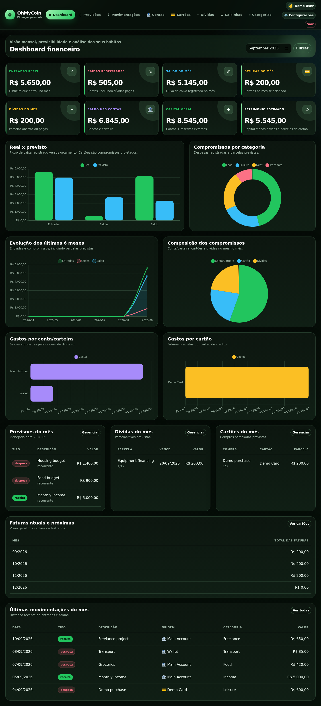
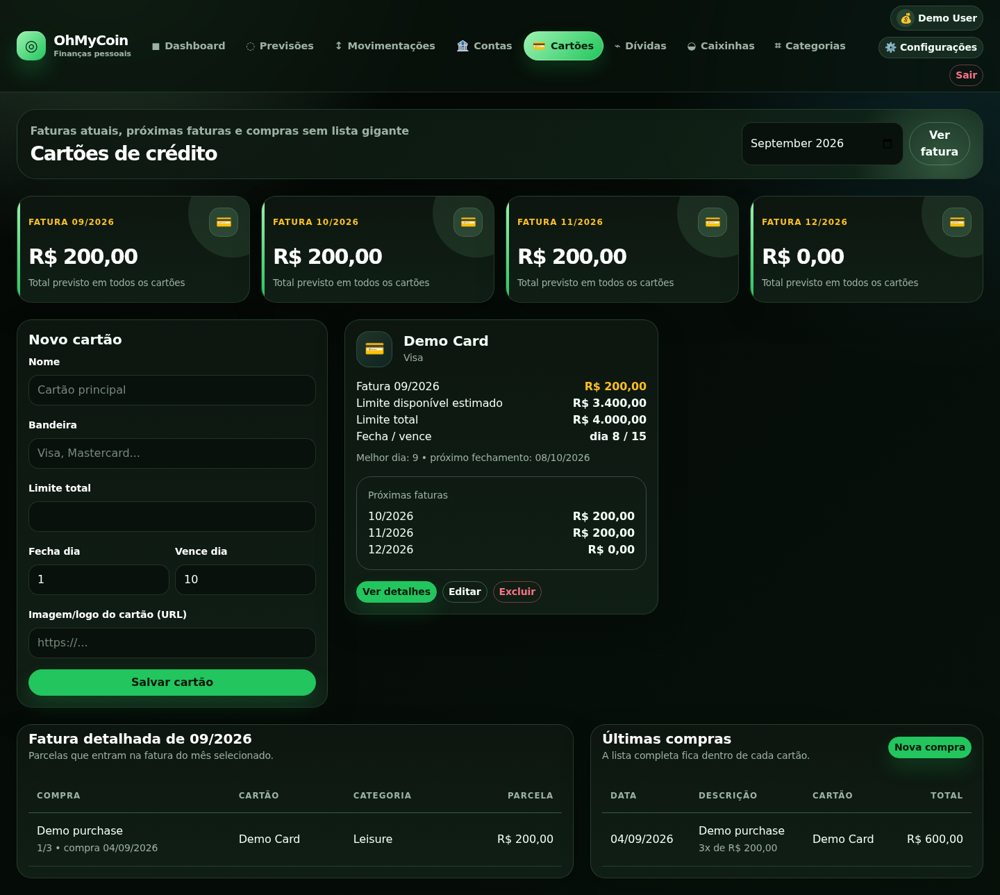
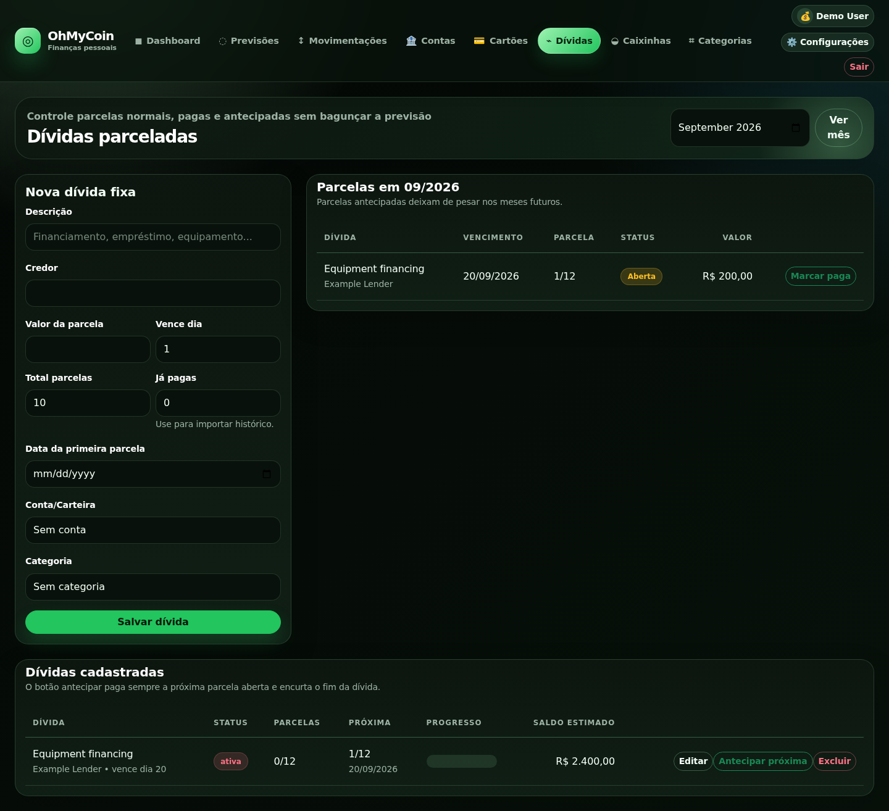

# OhMyCoin — Personal Finance Management Platform

**Português:** [Comece aqui](LEIA-ME-PRIMEIRO.md) · [Kit de publicação](divulgacao/GUIA_DE_PUBLICACAO.md) · [Validação](VALIDACAO.md)

A server-rendered personal-finance application built with Python, Flask and MySQL. It brings together accounts, transactions, budgets, credit-card installments, debt payments and savings goals.

The project focuses on maintainable financial rules: separating domain services,
preserving financial invariants, enforcing data ownership and providing a
reproducible environment. It is not a banking integration or a regulated
financial product.

## Screenshots

Real application screenshots with fictional demo data. [All 20 desktop/mobile screenshots](docs/screenshots/).



<details>
<summary>Credit cards and debt management</summary>





</details>

## Quick start

Requirements: Docker Engine/Desktop with Docker Compose v2.

```bash
cp .env.example .env
docker compose up --build
```

Open [http://localhost:5000](http://localhost:5000).

**Local demo:** `demo@example.com` / `Demo@12345`.

The defaults are disposable local examples, not production credentials. Compose binds the web application to loopback only; MySQL has no published port. A new MySQL volume receives the schema. A Python CLI generates the demo password hash and loads fictional records; subsequent starts preserve them.

The placeholder session secret is replaced with a random development secret in memory. Gunicorn preloads the application so workers share it. Set your own persistent random `SECRET_KEY` to keep sessions valid across restarts. Replace every credential placeholder before any non-local deployment.

To stop without deleting data:

```bash
docker compose down
```

To replace **only the fictional demo user's data** (destructive for that demo account):

```bash
docker compose exec web python -m flask --app run seed-demo --reset
```

Set `DEMO_MODE=False` before first startup for an empty installation. Demo initialization is rejected in production. This is a local evaluation environment, not a public shared demo with periodic resets.

## Features

- Registration, login, logout, profile, password changes and administrator user management.
- BRL accounts, wallet, categories and filtered income/expense records.
- Monthly and recurring budgets.
- Credit-card purchases with closing dates, due dates, installment rounding and invoice projections.
- Debt schedules, imported paid history, out-of-order payments, early payments and transactional reversal.
- Savings goals with contributions, withdrawals and estimated completion.
- Dashboard, cash-flow comparison and obligation breakdowns.
- Light/dark themes, responsive tables and CSP-compatible deletion confirmations.

## Stack and architecture

| Area | Technology / responsibility |
| --- | --- |
| Runtime | Python 3.12, Flask, Gunicorn |
| Persistence | MySQL 8.4, mysql-connector-python, explicit parameterized SQL |
| Presentation | Jinja, Bootstrap 5, Chart.js |
| Services | Accounts, transactions, cards, debts, budgets, savings, users, dashboard |
| Quality | Pytest, Ruff, Bandit, pip-audit, browser smoke checks |
| Delivery | Docker Compose and GitHub Actions |

Routes validate authentication and authorization and delegate to domain services under `app/services/`. `database.db_cursor` owns transactions and cleanup. Invariant-sensitive operations use row locks, rather than read/modify/write across independent transactions.

The former monolithic service module is no longer used. See [Architecture](docs/ARCHITECTURE.md).

## Financial semantics

- Money uses `Decimal` / `DECIMAL(12,2)`; installment remainders go to the final installment.
- Cash-flow metrics count recorded account income and expenses. Unpaid debt and card installments are **commitments**, not settled cash.
- Paying a debt creates one expense. Removing that expense reverses the payment and restores the schedule.
- Card purchases appear once in the unified transaction view.
- Card limit and net-worth figures are **estimates**: the application does not reconcile paid card invoices; earlier invoices are assumed settled.
- Savings goals are separate external reserves, not allocations of an existing account balance. Entering the same money in both places would double-count assets.
- Budgets are independently entered plans, not automatically matched to actual transactions.

These boundaries, including interest and currency limitations, are detailed in [Financial rules](docs/FINANCIAL_RULES.md).

## Security

Password hashing, session revocation after password changes, CSRF checks on unsafe methods, fresh role/active-user checks, ownership validation, parameterized queries, login throttling and security headers are implemented.

Production configuration rejects debug/testing, missing or known-placeholder session secrets, insecure cookies and empty database passwords. The local Compose topology is not a production deployment recipe.

[Security](docs/SECURITY.md) documents remaining limits and operational requirements. A green scanner is not a guarantee that no vulnerability exists.

## Production deployment

The container reads the platform-provided `PORT` and runs as an unprivileged
user. Provision an empty MySQL database, keep it on a private network, and run
`python -m flask --app run init-db` as a controlled pre-deploy step. The command
applies the baseline schema but does not load demo or personal data.

Production configuration must set `APP_ENV=production`, disable debug and demo
mode, require secure cookies, and provide unique `SECRET_KEY` and database
credentials through the hosting platform's secret store. Never upload a real
`.env` file or expose the database directly to the internet. Configure the
platform health check to use `/readyz`.

## Test and inspect

```bash
python -m venv .venv
source .venv/bin/activate
pip install -r requirements.txt -r requirements-dev.txt
python -m pytest -q unit_tests
ruff check app tests unit_tests scripts config.py database.py run.py
bandit -r app config.py database.py
pip-audit -r requirements.txt
```

Windows PowerShell activation: `.\.venv\Scripts\Activate.ps1`.

Integration tests require a **disposable** MySQL database whose name ends in `_test`. They truncate test tables. See [Testing](docs/TESTING.md) before running the full suite.

CI runs unit/integration tests with MySQL, compilation, lint, security and dependency scans. A separate job builds the real Compose environment, tests demo login/readiness/pages/restart, and checks desktop/mobile rendering in Chromium. Browser screenshots are attached to that CI run as `demo-browser-screenshots`; they contain fictional demo data.

## Run without Docker

Create an empty MySQL 8.4 database and a dedicated application user. Configure `.env` and install dependencies as above, then:

```bash
mysql -u your_user -p ohmycoin < migrations/001_schema.sql
python -m flask --app run seed-demo
python run.py
```

As an alternative to the MySQL client command, `python -m flask --app run init-db`
applies the baseline to an already-created empty database. The demo SQL is an
implementation detail of `seed-demo`: do not execute it directly, as the CLI
binds the generated password hash. Omit the seed command for an empty
installation.

`/healthz` checks the process; `/readyz` checks database connectivity and the users table. Production schema and privilege management are separate deployment responsibilities.

## Documentation

- [Architecture](docs/ARCHITECTURE.md)
- [Financial rules and trade-offs](docs/FINANCIAL_RULES.md)
- [Database](docs/DATABASE.md)
- [Security](docs/SECURITY.md)
- [Testing](docs/TESTING.md)
- [Private-to-public release procedure](docs/PUBLICATION.md)

## Next steps

Invoice settlement/reconciliation, versioned incremental migrations, query profiling/pagination, broader browser/accessibility testing and production monitoring are explicit next steps. Features are intentionally kept in Flask/Jinja; introducing a frontend framework or an ORM is not necessary to demonstrate these backend engineering decisions.
