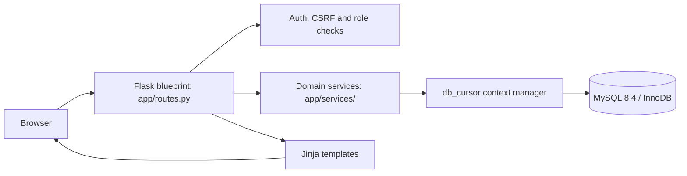
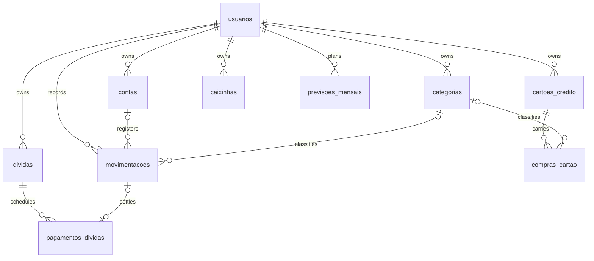

# OhMyCoin — Architecture and SQL decisions

## Purpose and scope

OhMyCoin is a server-rendered **personal-finance portfolio project**, not a
payment gateway or a bank. It manages manually entered BRL financial records.
It deliberately does not claim to reconcile bank statements or settled credit
card invoices.

## Request and persistence flow

The routes handle HTTP and authorization. Services validate domain rules and
perform the financial operations. Explicit parameterized SQL allows inspecting
joins, row locks and query plans without an ORM. MySQL manages foreign keys,
constraints and transactional consistency.

## Relational model (simplified)

This diagram omits audit, login attempts and secondary relationships. Refer to
[`schema.sql`](../app/sql/schema.sql) for the authoritative database schema.
Most foreign keys currently enforce existence of referenced rows, while the
services enforce *same-user ownership*; adding tenant-scoped composite FKs is a
future defense-in-depth improvement.

## Engineering decisions

| Choice | Reason / trade-off |
| --- | --- |
| Flask + Jinja | Lightweight server-side UI; a separate frontend would add complexity without helping demonstrate the backend rules. |
| SQL with parameters | Explicit control over transactional semantics, at the cost of more handwritten query and mapping code. |
| Decimal / DECIMAL(12,2) | Deterministic cents rather than binary floating-point calculations; the final card installment absorbs rounding residue. |
| InnoDB transactions | Debt payment and reversal must update installment status and the linked expense atomically. |
| SELECT ... FOR UPDATE | Prevents concurrent payments or savings withdrawals from using the same stale balance. |
| Stable card billing dates | Instead of silently rewriting older invoices, a card containing purchases rejects edits to closing/due dates. Create a replacement card for a new billing cycle. |
| Deactivate over deleting history | A card with purchases cannot be deleted; an inactive card retains its historical invoices. |

## Core invariants worth testing

- Each debt installment can be paid at most once; paying creates exactly one
  expense, and reversing that expense reopens the installment.
- Cancelled debt schedules do not create new future obligations; already paid
  installments remain visible.
- A purchase split across installments preserves the exact total in cents.
- Card setting changes do not retroactively move transactions between months.
- Every transaction, card, account and category belongs to the requesting user.
- Concurrent savings withdrawals never produce a negative amount.
- Funds in externally held savings goals are not automatically subtracted from
  an account; including both in capital may double-count if the user records
  the same money twice.

## Quality gates

[GitHub Actions](../.github/workflows/ci.yml) runs Pytest against disposable
MySQL, Ruff, Bandit, pip-audit, Docker smoke checks and Chromium desktop/mobile
rendering checks. Coverage is reported in CI; 100% line coverage is not
considered proof of business-rule correctness.

## Known limitations / next engineering steps

1. Full invoice payment and bank reconciliation are not implemented. Net worth,
   remaining card limit and future statements are estimates.
2. Incremental SQL migrations and tenant-scoped composite foreign keys should
   be introduced before larger schema changes.
3. The transactions table and some reports use fixed result limits. Implement
   stable pagination and database-side filtering for large data volumes.
4. Add database query profiling, financial integration scenarios and production
   observability before using this with sensitive real-world information.
